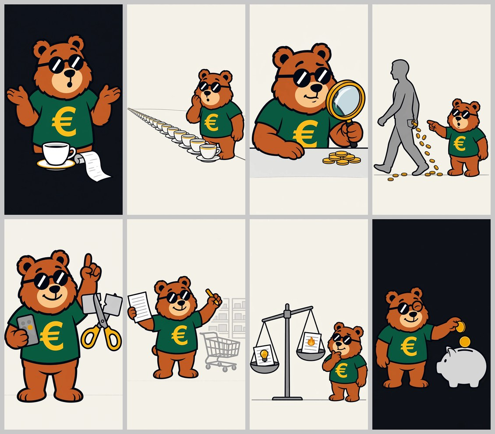

# Immagini: risparmio quotidiano (video TikTok)

Le 8 illustrazioni del video "consigli pratici per risparmiare nella vita di tutti i giorni". Senza testi: titoli, sottotitoli e il fumetto "But Why Finance?" si aggiungono in montaggio.

| File | Contenuto |
|---|---|
| `01.png` … `08.png` | Immagini finali, PNG **1080x1920** (9:16) |
| `prompts.json` | Prompt finale (in inglese) di ogni immagine, con fondo e presenza dell'orso |
| `anteprima.jpg` | Contact sheet con le 8 immagini affiancate |

## Le 8 immagini

| # | Fondo | Scena | Tentativo usato |
|---|---|---|---|
| 01 | inchiostro | Orso sorpreso (bocca a "o", zampe aperte), tazzina in primo piano e striscia di scontrino bianca con sole righe grigie | 1° |
| 02 | carta | Fila infinita di tazzine bianche con bordo ambra in prospettiva, orso accanto, sorpreso, zampa sulla guancia | 1° |
| 03 | carta | Orso dietro un tavolo con una grande lente (bordo ambra) sul mucchietto di monetine ambra, curioso | 1° |
| 04 | carta | Sagoma grigia che cammina guardando altrove, dalla tasca cadono monetine ambra; orso più piccolo che indica, incredulo | 1° |
| 05 | carta | Tip 1 abbonamenti: orso con smartphone (icone tonde astratte) e indice alzato; grandi forbici ambra tagliano a metà una tessera grigia | 2° |
| 06 | carta | Tip 2 lista della spesa: orso con foglio a righe e matita ambra, carrello grigio e scaffali grigi sullo sfondo | 3° |
| 07 | carta | Tip 3 luce e gas: bilancia grigia con due fogli a righe (lampadina ambra / fiammella ambra), orso pensieroso con mano al mento | 3° |
| 08 | inchiostro | Orso con occhiolino (occhio chiuso visibile nella lente) che infila una moneta ambra in un salvadanaio grigio; spazio libero in alto a destra | 2° |

Nessun rosso, nessun verde oltre alla maglietta dell'orso, unico accento ambra (`#E9A400`), nessuna scritta/lettera/numero.

## Come sono state generate

Stesso metodo del video [`../../2026-10-il-prezzo-del-caffe/`](../../2026-10-il-prezzo-del-caffe/README.md) (script `script/gen.py` e `script/make_prompts.py` di quel video, prompt adattati alle nuove scene):

- API Meta `POST https://api.meta.ai/v1/images/edits` (multipart, autenticazione fatta dal proxy, nessuna chiave), modello `muse-image-1.0`, `size=1024x1792`, `n=1`, `response_format=b64_json`.
- Riferimento sempre `brand/mascotte/mascotte-principale.jpg` come `image[0]`. Per la 08 anche `brand/mascotte/espressioni.jpg` come `image[1]`, per copiare l'occhiolino del set di espressioni.
- Risposta WebP 1152x2016 → ritaglio centrato a 1134x2016 (9:16, 9 px per lato) → ridimensionamento a 1080x1920 (Pillow, Lanczos). Nessuna deformazione.

Struttura del prompt: `Vertical 9:16 illustration…` + [ORSO] + [STILE] + `Scene:` [SCENA] + [FONDO] + [COMPOSIZIONE] + [PALETTE] + [NIENTE TESTO]. Rispetto al video del caffè:

- **ORSO**: aggiunto "euro symbol … clearly visible and not covered by props; plain short sleeves without any symbol" (contro la € coperta o sulla manica).
- **COMPOSIZIONE** (nuovo): "the top 12% and the bottom 18% of the image are completely empty background … nothing touches the bottom edge". Nel video del caffè l'orso e gli oggetti arrivavano al bordo basso.
- **PALETTE**: niente marroni caffè; "No red anywhere, no pink, no blue, no other green objects besides the bear's t-shirt".
- **SAGOMA**: inclusa da subito la frase che nel caffè aveva risolto la maglietta verde ("the whole figure including the torso is plain flat grey with no clothes, no t-shirt, no logo").
- **NIENTE TESTO**: "… any paper is blank or has only abstract grey lines".

## Cosa è stato rigenerato e perché

14 immagini generate in tutto (8 prime prove + 6 rigenerazioni), più 2 richieste fallite con `HTTP 502 upstream request failed` (errore temporaneo del server, ripetute senza modifiche). Nessun blocco del filtro contenuti.

| Img | Problema | Correzione |
|---|---|---|
| 05 | 1ª prova: la tessera era diventata 3-4 rettangoli grigi impilati e non si capiva il taglio; forbici più arancio che ambra | Chiesta "ONE single … card being cut in two", due metà che si separano, forbici con manici ambra pieni. 2ª prova buona |
| 06 | 1ª e 2ª prova: il foglio e il braccio **coprivano la € sulla maglietta**; nella 2ª anche il riflesso degli occhiali era grigio e sbiadito | 3ª prova: foglio tenuto in alto e di lato, "chest and the big yellow euro symbol … completely uncovered" |
| 07 | 1ª prova: fogli, lampadina e fiammella **nella fascia alta** (dove va il titolo). 2ª prova: composizione giusta ma sui fogli **scarabocchi** invece di righe | Scena ricomposta (bilancia a sinistra con i due fogli sui piatti, orso a destra); poi "five neat straight grey horizontal lines … no scribbles". 3ª prova buona |
| 08 | 1ª prova: per l'occhiolino **mancava una lente** (occhiali a "monocolo") e i piedi arrivavano quasi al bordo basso | Aggiunto `espressioni.jpg` come secondo riferimento e "both round black sunglasses lenses are present, one lens shows the closed eye"; orso più piccolo. 2ª prova buona |

01-04 riuscite al primo tentativo.

## Controlli fatti

Ogni immagine guardata intera e, per scontrini e fogli, anche ingrandita: nessuna scritta o cifra, solo righe grigie. Fondo misurato sui bordi e ingombro verticale del contenuto (percentuale dell'altezza, dall'alto):

| # | Fondo misurato | Contenuto da… a… |
|---|---|---|
| 01 | `#0E1219` | 14,8% – 84,2% |
| 02 | `#F4F1E9` | 30,6% – 75,2% |
| 03 | `#F4F1E9` | 18,1% – 82,3% |
| 04 | `#F4F1E9` | 26,0% – 84,1% |
| 05 | `#F4F1EA` | 14,3% – 87,2% |
| 06 | `#F4F1E9` | 26,9% – 76,8% |
| 07 | `#F4F1E9` | 39,9% – 87,0% |
| 08 | `#0E1218` | 32,4% – 80,1% |

Fascia alta (10%) libera in tutte.

## Difetti noti

- **05 e 07: fascia bassa libera ~13%** invece del 15% (piedi dell'orso e linea del pavimento a 87%). Se il sottotitolo li copre, basta un leggero zoom/spostamento in montaggio o accettare che copra i piedi.
- **Fondo inchiostro** misurato `#0E1219`, non esattamente `#111418` (differenza minima, invisibile a occhio; se in montaggio si affianca un riquadro pieno `#111418` si può notare).
- **03**: il vetro della lente è grigio-azzurro chiaro (unica traccia di azzurro), e la lente copre in parte la spalla; la € resta visibile. Il piano del tavolo è una fascia grigia larga (70-82% dell'altezza).
- **04**: la sagoma ha il profilo del naso accennato (nessun occhio, bocca o dettaglio); le monetine escono dalla tasca davanti, non da quella posteriore.
- **06**: l'orso non sta scrivendo sul foglio: tiene il foglio in una zampa e la matita alzata nell'altra (si legge come "ho fatto la lista"). Le versioni in cui scriveva coprivano la €.
- **07**: la bilancia è un po' inclinata (non in pari); funziona comunque come "confronto tra due offerte". Lampadina e fiammella sono piccole.
- **02**: l'orso è più grande di "piccolo a lato" (circa metà altezza), e la linea del pavimento è irregolare.
- **08**: due monete (una in mano, una sopra la fessura), si legge come la moneta che cade.

**Coerenza dell'orso:** in tutte e 8 le immagini l'orso è riconoscibile e coerente con `mascotte-principale.jpg`: pelliccia ramata, muso pesca, naso nero con linea, occhiali tondi neri con riflesso bianco diagonale, maglietta verde scuro con € gialla al centro del petto e visibile, contorno nero spesso. Le proporzioni cambiano leggermente tra mezzo busto e figura intera (più tozzo nella 05).

**Su TikTok va attivata l'etichetta "contenuto generato da IA".**
