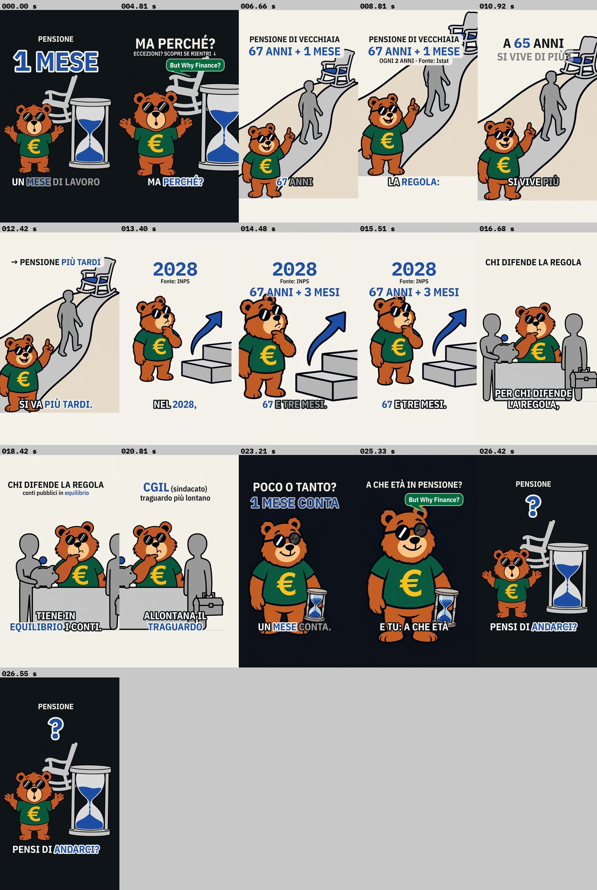

# Il numero: 67 anni e 1 mese — video TikTok

**Stato: post definitivo (testi, immagini, voce e video montato)** · da pubblicare dopo le verifiche della checklist (fonti lette solo in sintesi).

Revisione: 3 giri con quattro valutatori + redattore (skill `rivedi-post-tiktok`), vedi [`revisione/stato.md`](revisione/stato.md). Produzione con `crea-post-tiktok` (immagini, copertina, voce dell'utente, montaggio) il 29-30/10/2026.

Rubrica: **Il numero** (accento blu `#1F4FA3`) · ordine di pubblicazione consigliato: **5** su 5 (vedi [`../2026-11-piano-5-video.md`](../2026-11-piano-5-video.md))



## Stato dei file

| File | Contenuto | Stato |
|---|---|---|
| `video.mp4` | video finale 1080x1920, 30 fps, **26,6 s**, voce + effetti, -14,5 LUFS, true peak -1,9 dBFS | pronto (controlli automatici a 0 errori, 0 avvisi) |
| `copertina.png` | copertina 1080x1920: orso intero + «PENSIONE / 1 MESE / DI LAVORO IN PIÙ» (IBM Plex Sans Condensed + Mono) | pronta |
| `voce.mp3` | voce ElevenLabs caricata dall'utente ("Valerio – Warm Italian Storyteller", 27,25 s) | pronta, testo controllato (sotto) |
| `trascrizione.md`, `sottotitoli.srt`, `tempi.json` | battute con i tempi, sottotitoli, tempi di inquadrature/titoli/effetti e controlli | pronti |
| `anteprima_video.jpg` | fotogrammi a 0 s, a ogni cambio e all'ultimo | pronta |
| `copione.md` | testo voce + production doc | approvato dalla revisione (75 parole) |
| `script/scene_elevenlabs.json`, `script/elevenlabs.txt` | scene e testo da incollare in ElevenLabs | pronti |
| `script/` (montaggio) | `monta.sh`, `config_video.py`, `montage.py`, `copertina.py` e gli altri script della skill | pronti (adattati, vedi "Montaggio") |
| `immagini/` | 5 PNG 1080x1920 + `scene.json`, `prompts.json`, `anteprima.jpg`, [`README`](immagini/README.md) | pronte (9 generazioni, 4 rigenerate) |
| `didascalia.md` | didascalia completa e breve, hashtag, commento fissato, risposte pronte | pronta, con un punto da verificare (sotto) |
| `ricerca.md` | fatti, fonti, tesi | fatti **letti solo in sintesi**: da confermare |
| `revisione/` | rapporti dei 3 giri e `stato.md` | chiusa |

## Riepilogo della revisione

| Giro | Verifica fatti | Ritenzione | Brand | Pubblico | Parole | Decisione |
|---|---|---|---|---|---|---|
| 1 | 3,3 · 2 bloccanti | 3,8 · 0 | 3,7 · 1 | 3,2 · 1 | 75 | redattore |
| 2 | 3,7 · 1 | 4,0 · 0 | 4,2 · 1 | 3,7 · 1 | 74 | redattore (hook dell'utente con «Per quasi tutti» + «Scopri se rientri») |
| 3 (finale) | **3,7** · 1 | **4,6** · 0 | **4,7** · 0 | **4,3** · 0 | 75 | redattore finale → produzione |

- La soglia (media ≥ 4,2 e nessun bloccante per tutti) non è stata raggiunta dalla **verifica dei fatti**: media 3,7, perché tutte le fonti sono state lette solo in sintesi (siti INPS, Camera, Istat non raggiungibili dalla sessione).
- Il bloccante **fatti-r3-1** (comparto difesa e sicurezza messo per errore fra le esclusioni) è stato **corretto dal redattore del giro 3 ma non rivalutato** da un quarto giro.

## Testo da incollare in ElevenLabs

Per rifare la voce (quella attuale è già registrata). Da [`script/elevenlabs.txt`](script/elevenlabs.txt).

**Versione 1 · eleven_v3, tag di tono in inglese (consigliata)**

```
[surprised] Un mese di lavoro in più. Per quasi tutti. Dal duemilaventisette. … [curious] Ma perché?
[matter-of-fact] Pensione di vecchiaia: sessantasette anni e un mese. La regola: se a sessantacinque anni si vive più a lungo, si va più tardi.
[calm] Nel duemilaventotto, sessantasette e tre mesi.
[thoughtful] Per chi difende la regola, tiene in equilibrio i conti. Per la Cgil, allontana il traguardo di chi lavora.
[warm] Poco o tanto, un mese conta. [curious] E tu: a che età pensi di andarci?
```

**Versione 2 · tag di tono in italiano**

```
[sorpreso] Un mese di lavoro in più. Per quasi tutti. Dal duemilaventisette. … [curioso] Ma perché?
[chiaro] Pensione di vecchiaia: sessantasette anni e un mese. La regola: se a sessantacinque anni si vive più a lungo, si va più tardi.
[calmo] Nel duemilaventotto, sessantasette e tre mesi.
[pensieroso] Per chi difende la regola, tiene in equilibrio i conti. Per la Cgil, allontana il traguardo di chi lavora.
[caldo] Poco o tanto, un mese conta. [curioso] E tu: a che età pensi di andarci?
```

(Se il modello legge ad alta voce i tag italiani, usa la versione 1 o la 3 per scene di `elevenlabs.txt`.)

## Voce: controllo del testo

Trascrizione automatica (`muse-spark-1.3`, file intero e 6 spezzoni, script `../2026-10-risparmio-quotidiano/script/transcribe.py`) confrontata con `scene_elevenlabs.json`:

- **Nessun tag letto ad alta voce, nessuna parola diversa o aggiunta.** Spezzoni: «Pensione di vecchiaia, 67 anni, e un mese. La regola, se a 65 anni si vive più a lungo, si va più tardi.» · «Nel 2028, 67 e tre mesi. Per chi difende la regola, tiene in equilibrio i conti.» · «Per la CGL, allontana il traguardo di Kilavora. Poco tanto, un mese conta. E tu, a che ta pensi di andare?» · «Dal 2027. Ma perché?».
- La trascrizione dell'intero file ripete frasi e aggiunge parole («Poco 80», doppio «67 e tre mesi»), e uno spezzone ha aggiunto «e 43 anni, 1 mese di contributi»: sono invenzioni del trascrittore (la durata, 27,25 s per 75 parole a 167 parole/min, e le pause non lasciano spazio a frasi in più; lo spezzone 5,4-13,2 s con la stessa frase non le riporta).
- **«Un» iniziale (rit-r2-3):** il trascrittore scrive sempre «Mese di lavoro in più», anche con 1 s di silenzio davanti. Nell'audio c'è però un tratto sonoro di ~0,25 s (0,08-0,33 s) prima del mormorio nasale della «m» e della «e» di «mese»: la parola sembra esserci, ma breve e attaccata. **Da ascoltare**: se non si sente, rigenerare la sola scena 1 con «UN MESE» nel `text_v3` (nota del copione).
- **«Cgil»** trascritta «CGL»: pronunciata come sigla («ci-gi-elle»), corretto.

## Montaggio

Catena della skill `crea-post-tiktok` (come il post risparmio v2), un comando dalla radice del repository:

```bash
bash brand/tiktok/output/2026-11-pensione-67-anni-un-mese/script/monta.sh brand/tiktok/output/2026-11-pensione-67-anni-un-mese/voce.mp3
```

- **Ritmo:** 75 parole; voce originale 27,25 s (167 parole/min) → pause oltre 0,4 s portate a 0,3 s, 0,36 s prima di «Ma perché?», **nessuna accelerazione** → parlato 26,15 s, **172 parole/min**; video 26,6 s (fine 0,45 s dopo l'ultima parola). Audio normalizzato a -14,5 LUFS integrati, true peak -1,9 dBFS; nessuna musica (si aggiunge in app).
- **15 inquadrature, cambio visivo più lungo 1,63 s**, una sola transizione (tenda, inchiostro → carta), punch-in 112% in 0,7 s nell'hook, zoom effettivo ≤ 115% nelle strette:

| # | Da (s) | Img | Inquadratura | Titoli a schermo |
|---|---|---|---|---|
| 1 | 0,00 | 01 | larga, punch-in | «PENSIONE» + «1 MESE» dal fotogramma 0 · «DI LAVORO IN PIÙ» → sostituita da «PER QUASI TUTTI» · «ECCEZIONI? SCOPRI SE RIENTRI ↓» · «PENSIONE · DAL 2027» al posto di «PENSIONE» |
| 2 | 4,33 | 01 | stretta orso + clessidra | «MA PERCHÉ?» + invito; fumetto "But Why Finance?" su «perché» |
| 3 | 5,13 | 02 | larga (tenda) | «PENSIONE DI VECCHIAIA» · «67 ANNI + 1 MESE» |
| 4 | 7,68 | 02 | media sull'orso | + «OGNI 2 ANNI · Fonte: Istat» |
| 5 | 9,56 | 02 | stretta sulla sagoma che cammina | «A 65 ANNI» · «SI VIVE DI PIÙ?» |
| 6 | 11,83 | 02 | sedia in cima | «→ PENSIONE PIÙ TARDI» |
| 7 | 12,82 | 03 | larga | «2028» + «Fonte: INPS» |
| 8 | 13,78 | 03 | stretta sul gradino alto | + «67 ANNI + 3 MESI» |
| 9 | 14,94 | 03 | media | (stessi) |
| 10 | 15,90 | 04 | larga | «CHI DIFENDE LA REGOLA» |
| 11 | 17,21 | 04 | stretta sulla sagoma col salvadanaio | + «conti pubblici in equilibrio» |
| 12 | 19,24 | 04 | stretta sulla sagoma con la cassetta | «CGIL (sindacato)» · «traguardo più lontano» |
| 13 | 21,86 | 05 | larga | «POCO O TANTO?» · «1 MESE CONTA» |
| 14 | 24,11 | 05 | stretta orso + clessidra | «A CHE ETÀ IN PENSIONE?»; fumetto su «che» |
| 15 | 26,15 | 01 | loop: vista del fotogramma 0, ferma | «PENSIONE» + «?» al posto di «1 MESE» |

- **Adattamenti agli script** (solo nelle copie di questo post): `montage.py` con accento blu (contorno carta su titoli e parole chiave dei sottotitoli), righe di titolo che escono (`fino`) e che prendono il posto della precedente (`sopra`); `frasi.py` ignora la pausa «…» del testo (non è una parola) e `monta.sh` cerca le pause da 0,12 s (con 0,08 s una micro-pausa dentro «duemilaventisette» spostava «Ma perché?»; variabile `FRASI_MIN`); `copertina.py` nuova.
- **Effetti:** colpo secco a 0,0 s, tick sui due «67». Il "ticchettio sotto a basso livello" del copione non c'è (nessun effetto continuo nella catena): eventualmente si aggiunge in app.
- **Controlli automatici:** 0 errori, 0 avvisi (occhiali mai coperti né tagliati, volto in campo, testi nelle zone sicure, zoom, cambio ≤ 2 s, loop con «?» nella stessa posizione di «1 MESE»). Guardati con Read il fotogramma 0, ogni cambio d'inquadratura, l'ingresso delle righe dell'hook (3,6 s con «ECCEZIONI? SCOPRI SE RIENTRI ↓»: la freccia esce nel font) e l'ultimo.

**Limiti:** non posso ascoltare: naturalezza, intonazione delle domande, il «Un» iniziale e i tagli delle pause non sono verificati da un orecchio. Le parole dentro le frasi sono stimate (errore atteso < 0,15 s). Nell'hook la clessidra arriva al bordo destro (zona dei pulsanti) e le righe dell'invito passano sopra lo schienale della sedia; nella scena 2 i titoli stanno su targhetta carta perché passano sopra sedia e sagoma.

## Didascalia

Pronta in [`didascalia.md`](didascalia.md): hashtag `#butwhyfinance #maperché #pensioni #pensione2027 #etàpensionabile`, domanda finale uguale al video («E tu, a che età pensi di andarci?»), etichetta IA nelle note, lista «Scopri se rientri in questi casi» e commento fissato.

**Punto da verificare (non cambiato):** nel commento fissato c'è «Per tutti gli altri il mese in più vale dal 2027, **per la pensione di vecchiaia e per l'anticipata**». Il dato sull'anticipata (riga 6 di `ricerca.md`, letto solo in sintesi) era stato tolto dal testo nel giro 1 perché non verificato: confermarlo sulla circolare INPS 28/2026 o togliere «e per l'anticipata» prima di pubblicare.

## Checklist di pubblicazione

- [ ] Fonti "letti in sintesi" aperte sull'originale (elenco da `ricerca.md`):
  - [ ] INPS, circolare n. 28 del 16/03/2026 e notizia "Pensioni: requisiti aggiornati per il 2027 e il 2028": 67a1m (2027), 67a3m (2028); parola per parola la lista delle esclusioni (gravosi, usuranti, precoci, APE sociale); comparto difesa e sicurezza **non** escluso; **anticipata +1 mese nel 2027** (commento fissato).
  - [ ] L. 199/2025 (legge di bilancio 2026), art. 1 c. 180-190 e decreto MEF-MLPS 19/12/2025 (GU 301 del 30/12/2025): divisione 1 + 2 mesi, testo delle esclusioni (APE sociale al c. 190), c. 180.
  - [ ] Meccanismo biennale sui dati Istat della speranza di vita a 65 anni (art. 12 DL 78/2010, art. 24 c. 13 DL 201/2011): «OGNI 2 ANNI · Fonte: Istat».
  - [ ] Cgil, nota di Lara Ghiglione del 23/01/2026: citazione testuale.
  - [ ] Osservatorio CPI (25/09/2025), PDF sul costo del blocco (tesi "chi difende la regola").
  - [ ] Il giorno dell'uscita: ddl di bilancio 2027 (CdM 28/10/2026), che non congeli lo scatto 2027 né cambi le esclusioni.
- [x] Voce registrata su ElevenLabs dalla versione 1, salvata come `voce.mp3` (caricata dall'utente il 29/10/2026).
- [ ] **Ascoltare** la voce: «Un» iniziale udibile, «Per quasi tutti.» non esclamato, domande che salgono.
- [x] Video montato con `script/monta.sh` e guardato nei fotogrammi: hook a 0,0 s, occhiali mai coperti, cambio ≤ 2 s (max 1,63 s), loop con «?». [ ] Guardarlo intero sul telefono.
- [ ] Copertina `copertina.png` caricata; didascalia e hashtag incollati alla lettera da `didascalia.md`.
- [ ] Commento fissato pubblicato subito, insieme al video (dopo aver deciso su «e per l'anticipata»).
- [ ] Etichetta TikTok **"contenuto generato da IA"** attivata (immagini e voce generate con IA).
- [ ] Musica solo dalla libreria commerciale di TikTok, bassa (~-20 dB sotto la voce).
- [ ] Eventuale A/B test dell'hook: il video monta la variante A di rit-r3-1; la variante B (a 0,0 s solo «1 MESE», «PENSIONE · DAL 2027» che entra a ~3,5 s) è in `revisione/r3-ritenzione.md` (in `config_video.py` basta togliere la riga «PENSIONE» dal titolo `hook` e dal `loop`).
