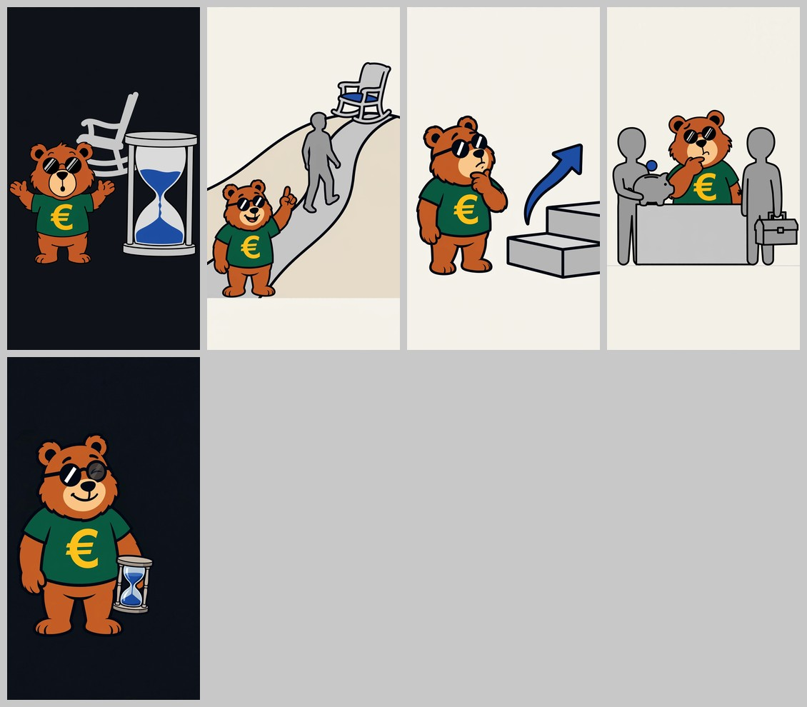

# Immagini: Il numero, 67 anni e 1 mese (video TikTok)

Le 5 illustrazioni del video, una per scena come prevede il copione (5 scene / 5 immagini). Il cambio visivo ogni ≤ 2 s si ottiene in montaggio con 2-4 inquadrature diverse della stessa immagine (`../script/config_video.py`, 15 inquadrature). Senza testi: «1 MESE», le cifre, i titoli, i sottotitoli e il fumetto "But Why Finance?" si aggiungono in montaggio.

| File | Contenuto |
|---|---|
| `01.png` … `05.png` | Immagini finali, PNG 1080x1920 (9:16) |
| `scene.json` | Scene in inglese (ingresso di `componi_prompt.py`), versione finale |
| `prompts.json` | Prompt finale di ogni immagine, con fondo e riferimenti |
| `anteprima.jpg` | Contact sheet |

La copertina (`../copertina.png`) non è un'immagine generata: è composta da `../script/copertina.py` con l'immagine 01 e i font del brand.

## Le 5 immagini

| # | Scena del copione | Fondo | Contenuto | Tentativo usato |
|---|---|---|---|---|
| 01 | 1 · hook | inchiostro | Orso intero sorpreso (bocca a "o", zampe alzate) nella metà bassa, grande clessidra con sabbia blu accanto, sedia a dondolo vuota grigia ben visibile dietro, lontana dagli occhiali; metà alta vuota per «PENSIONE / 1 MESE» | 2° |
| 02 | 2 · la regola | carta | Collina liscia beige chiaro senza erba né alberi, sentiero grigio chiaro, sagoma grigia senza volto che sale, in cima sedia a dondolo grigia con cuscino blu; orso intero in basso a sinistra che spiega con l'indice alzato | 2° |
| 03 | 3 · 2028 | carta | Due gradini grigi lisci (il secondo più alto), freccia blu senza segni che sale verso il gradino alto; orso pensieroso (mano al mento) che guarda in su. "Nessuna scritta" nel prompt | 2° |
| 04 | 4 · due tesi | carta | Tavolo grigio chiaro; a sinistra sagoma con salvadanaio grigio e moneta blu liscia, a destra sagoma con cassetta degli attrezzi grigia; orso pensieroso al centro dietro il tavolo, € libera. "Nessuna scritta" nel prompt | 1° |
| 05 | 5 · chiusura | inchiostro | Orso intero con l'occhiolino (lente fumé con l'occhio chiuso visibile, l'altra nera piena con riflesso), clessidra dell'hook tenuta di lato all'altezza del fianco, € e occhiali liberi, spazio in alto per il fumetto | 2° |

Unico accento blu (`#1F4FA3`, rubrica Il numero: sabbia, cuscino, freccia, moneta), nessun rosso né rosa, nessun verde oltre alla maglietta dell'orso, collina e sentiero neutri, nessuna scritta/lettera/numero. Fondo inchiostro solo su hook e chiusura (il copione non prevede schermate a fondo blu pieno: il numero gigante è un titolo del montaggio).

## Come sono state generate

API Meta `POST /v1/images/edits`, `muse-image-1.0`, `size=1024x1792`, riferimento `brand/mascotte/mascotte-principale.jpg` (`image[0]`) + `brand/mascotte/espressioni.jpg` (`image[1]`) per l'occhiolino della 05; WebP 1152x2016 → 1134x2016 → 1080x1920. Script: `.claude/skills/crea-post-tiktok/scripts/` (`componi_prompt.py` → `genera_immagine.py` → `controlla_immagini.py` → `anteprima.py`). Prompt con i blocchi fissi del brand (orso, stile, fondo, composizione con 12% in alto e 18% in basso liberi e fascia destra, palette blu, niente testo).

## Cosa è stato rigenerato e perché

9 immagini generate in tutto (5 prime prove + 4 rigenerazioni), nessuna richiesta fallita né bloccata dal filtro.

| Img | Problema della 1ª prova | Correzione (2ª prova, usata) |
|---|---|---|
| 01 | Orso e clessidra fino al 91% dell'altezza (fascia bassa occupata), sedia tagliata dal bordo destro e mezza nascosta dietro la clessidra | Orso più piccolo (~35% dell'altezza, piedi al ~76%), "nothing below 80%", sedia visibile fra orso e clessidra e lontana dal bordo |
| 02 | Orso in basso a sinistra fino al 96% (piedi sul bordo dei sottotitoli e dell'app) | Scena tra 25% e 80%, orso che sta sul piede della collina, fascia bassa vuota senza linea del pavimento |
| 03 | **Freccia rivolta in giù** sul gradino alto (si leggeva "scende"), orso grande, gradini fino al 86% | Freccia che sale ("arrowhead points up… never down"), orso più piccolo, scena tra 20% e 78% |
| 05 | Piedi nella fascia bassa (89%), clessidra fino al bordo destro e all'altezza del petto | Orso più piccolo, clessidra all'altezza del fianco, entro l'80% della larghezza |

04 riuscita al primo tentativo. Le prime prove sono rimaste nello scratchpad (non nel repository).

## Controlli fatti

Ogni immagine guardata intera con Read: nessuna scritta, cifra o segno (gradini lisci, moneta liscia, clessidre senza tacche), occhiali tondi con riflesso in tutte, € gialla al centro del petto e scoperta in tutte, sagome grigie senza volto né vestiti, niente rosso. Misure di `controlla_immagini.py` sulle immagini finali:

| # | Dimensioni | Fondo misurato | Contenuto da… a… (altezza) | Destra fino a | Avvisi |
|---|---|---|---|---|---|
| 01 | 1080x1920 | `#0F1319` (inchiostro) | 24,7% – 74,7% | 98,4% | contenuto nel 10% a destra |
| 02 | 1080x1920 | `#F4F1E9` (carta) | 16,0% – 84,9% | 100,0% | contenuto nel 10% a destra |
| 03 | 1080x1920 | `#F4F1EB` (carta) | 31,6% – 79,2% | 100,0% | contenuto nel 10% a destra |
| 04 | 1080x1920 | `#F3F0E8` (carta) | 29,9% – 75,5% | 99,4% | contenuto nel 10% a destra |
| 05 | 1080x1920 | `#0C111A` (inchiostro) | 22,9% – 80,8% | 75,1% | ok |

## Difetti noti

- **Fascia destra (01-04):** clessidra (01), collina e sedia (02), gradini (03) e cassetta degli attrezzi (04) arrivano al bordo destro. Nessun elemento importante (occhiali, €, volto) è in quella fascia; in montaggio i controlli di `montage.py` verificano che occhiali e testi restino fuori dai 120 px a destra.
- **01:** la sedia a dondolo è disegnata a tratto grigio senza il contorno nero spesso del resto dell'illustrazione (sembra più "lontana"); si riconosce bene. Nel fotogramma d'apertura la riga «ECCEZIONI? SCOPRI SE RIENTRI ↓» passa sopra lo schienale della sedia: si legge (contorno inchiostro).
- **02:** la collina finisce con un bordo orizzontale netto al ~85% dell'altezza e tocca i due bordi laterali: in montaggio solo viste con zoom ≥ 1 e centrate, per non mostrarne il taglio.
- **04:** il tavolo ha una leggera sfumatura di grigio (lo stile chiede colori pieni); a misura di telefono non si nota.

**Coerenza dell'orso:** stessa pelliccia ramata, muso pesca, occhiali tondi con riflesso diagonale e maglietta verde con € gialla in tutte e 5; nella 05 l'occhiolino si legge attraverso la lente fumé come nella 08 del post risparmio.

**Su TikTok va attivata l'etichetta "contenuto generato da IA".**
