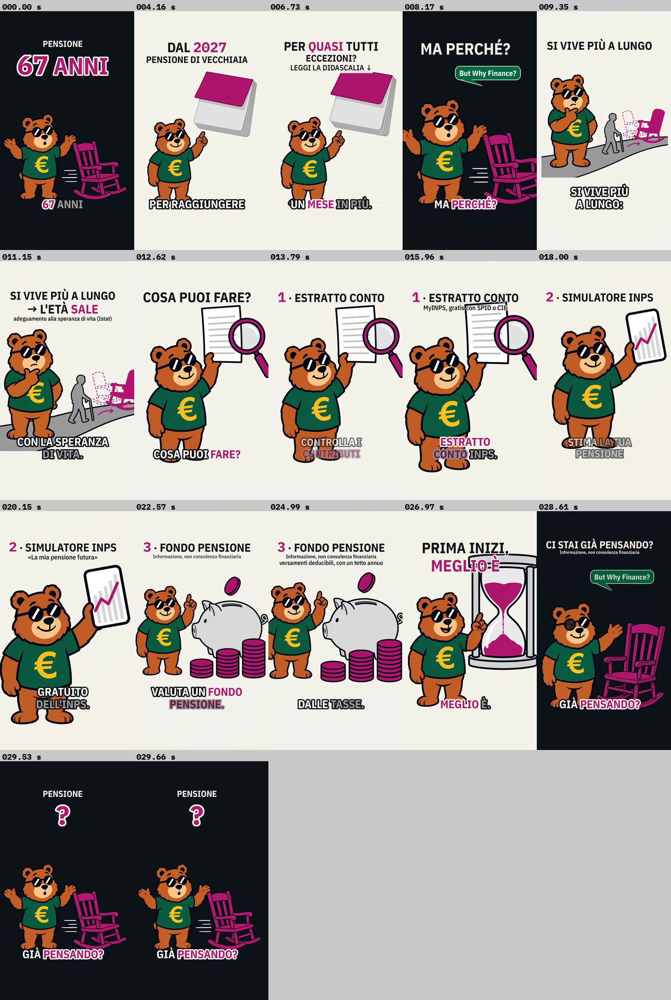

# In 60 secondi · Pensione a 67 anni e un mese: cosa puoi fare (TikTok, v2)

**Stato: post definitivo con video (da ascoltare).** Testo approvato dall'utente, voce ElevenLabs del 30/10/2026 **tenuta così com'è** (l'utente ha ricaricato lo stesso file e chiesto di montarlo), video montato con i controlli automatici a 0 errori. Fonti tutte **lette solo in sintesi**.

Rubrica: **In 60 secondi** (accento fucsia `#B0186E`, unico accento) · 80 parole parlate, **video 29,7 s, 164 parole/min, nessuna accelerazione** · post precedente sullo stesso tema, lasciato com'era: [`../2026-11-pensione-67-anni-un-mese/`](../2026-11-pensione-67-anni-un-mese/README.md)



## Cosa è cambiato (30/10/2026)

L'utente non ha gradito lo speech "Vero o falso? Il governo alza l'età pensionabile" e l'ha cambiato del tutto: dire che l'età pensionabile si alza, dare **consigli finanziari semplici** su cosa fare per tutelarsi e chiedere cosa ne pensano. Quindi:

1. **Rubrica** da *Vero o falso?* (viola) a ***In 60 secondi*** (fucsia): spiega un meccanismo in modo compatto (perché l'età sale) e poi tre passi pratici. *Il numero* (blu) è già del post precedente.
2. **Immagini tutte nuove** in fucsia (le 8 viola avevano oggetti viola pensati per il verdetto: timbro, ingranaggi, cubi, bilancia).
3. **Regola di brand nuova** (decisione dell'utente): consigli finanziari semplici e generali sì, mai prodotti/fondi/titoli specifici né importi o rendimenti promessi, sempre l'avvertenza "informazione, non consulenza". Aggiornati `references/brand.md`, `SKILL.md`, `controllo-qualita.md`, `copione.md`, `didascalia.md`, `ricerca.md` di `crea-post-tiktok`, la rubrica di `rivedi-post-tiktok` e i valutatori `bwf-valuta-brand`, `bwf-valuta-pubblico`, `bwf-redattore`.

## Contenuto della cartella

| Elemento | File | Stato |
|---|---|---|
| Video | `video.mp4`: 1080x1920, 30 fps, **29,7 s**, voce + effetti, -14,8 LUFS, true peak -1,7 dBFS | pronto (controlli automatici 0 errori, 0 avvisi) |
| Fotogrammi | `anteprima_video.jpg` (0 s, ogni cambio, ultimo) | pronta |
| Trascrizione, sottotitoli, tempi | `trascrizione.md`, `sottotitoli.srt`, `tempi.json` | pronti |
| Voce | `voce.mp3` (ElevenLabs, "Valerio – Warm Italian Storyteller", 30,04 s) | tenuta; scena 1 diversa dal testo approvato (sotto) |
| Ricerca e fonti | [`ricerca.md`](ricerca.md) | 9 righe, **tutte lette in sintesi** (inps.it e gli altri siti non raggiungibili), 3 non usate |
| Copione + production doc | [`copione.md`](copione.md) | allineato alla registrazione; tempi del video montato |
| Scene ElevenLabs | [`script/scene_elevenlabs.json`](script/scene_elevenlabs.json), [`script/elevenlabs.txt`](script/elevenlabs.txt) | allineate alla registrazione del 30/10 (tre versioni) |
| Immagini | [`immagini/`](immagini/README.md): 8 PNG 1080x1920, `scene.json`, `prompts.json`, `anteprima.jpg` | pronte · 11 generazioni, 3 rifatte |
| Copertina | [`copertina.png`](copertina.png) (`script/copertina.py`) | pronta: orso sorpreso + sedia che scappa, «PENSIONE / 67 ANNI / + 1 MESE» |
| Didascalia | [`didascalia.md`](didascalia.md) | pronta (invariata): completa, breve, commento fissato, risposte pronte |
| Montaggio | `script/` (`monta.sh`, `config_video.py`, `montage.py`, `frasi.json`, `parole.json` e gli altri script) | usato per il video |

## Voce: la scena 1 registrata

Trascrizione (`muse-spark-1.3`, `script/transcribe.py`, file intero e 8 spezzoni) confrontata con il testo approvato:

- **Scena 1 diversa:** l'audio dice «Dal duemilaventisette, **per raggiungere la pensione di vecchiaia, si dovrà lavorare un mese in più**» invece di «Dal duemilaventisette, **per quasi tutti, la pensione di vecchiaia si sposta più in là**». L'utente ha scelto di tenerla: testi (`scene_elevenlabs.json`, `elevenlabs.txt`, `copione.md`, sottotitoli) **allineati al parlato**.
- **A voce manca «per quasi tutti»** e «si dovrà lavorare un mese in più» è una **semplificazione** (il requisito è l'età, 67 anni e 1 mese). La precisazione è affidata allo **schermo** e alla **didascalia**: **«PER QUASI TUTTI»** grande (100 px, «QUASI» fucsia) entra a **5,4 s**, proprio su «si dovrà lavorare…», con **«ECCEZIONI?» + «LEGGI LA DIDASCALIA ↓»** (76 e 62 px) su «mese» a 6,5 s; restano fino a «Ma perché?» (7,6 s). La didascalia ha le eccezioni complete.
- **Il resto è uguale al testo approvato**, nessun tag letto. (La trascrizione del file intero aggiunge «Ma tu quando andrai in pensione?», che negli spezzoni non c'è: invenzione del trascrittore.) `frasi.py` ha allineato le 17 frasi alle pause con uno scarto medio di 1,1 sillabe.

## Montaggio

```bash
bash brand/tiktok/output/2026-11-pensione-mese-in-piu-v2/script/monta.sh brand/tiktok/output/2026-11-pensione-mese-in-piu-v2/voce.mp3
```

- **Ritmo:** 80 parole; voce 30,04 s (160 parole/min sul parlato) → pause oltre 0,4 s portate a 0,3 s (5 pause; 0,36 s prima di «Ma perché?»), **nessuna accelerazione** (`VMAX=1.0` in `monta.sh`, velocità 1,000x) → parlato 29,26 s, **164 parole/min**; video **29,7 s** (fine 0,45 s dopo l'ultima parola). Sotto l'obiettivo 165-175 di 1 parola/min, per scelta (nessuna accelerazione). Audio -14,8 LUFS integrati, true peak -1,7 dBFS (`norm.sh` punta a -14; dopo l'AAC resta -14,8, come negli altri post); nessuna musica.
- **16 inquadrature, cambio visivo più lungo 1,74 s**, una sola transizione (tenda, inchiostro → carta), punch-in 112% nell'hook, zoom ≤ 115%:

| # | Da (s) | Img | Inquadratura | Titoli a schermo |
|---|---|---|---|---|
| 1 | 0,00 | 01 | larga, punch-in, colpo | «PENSIONE» + «67 ANNI» dal fotogramma 0 · «+ 1 MESE» su «mese» (1,6) |
| 2 | 2,29 | 02 | larga 85% (tenda) | «DAL 2027» · «PENSIONE DI VECCHIAIA» su «raggiungere» (3,9) |
| 3 | 5,41 | 02 | media 90%, targhetta | **«PER QUASI TUTTI»** · «ECCEZIONI?» + «LEGGI LA DIDASCALIA ↓» (6,5) |
| 4 | 7,62 | 01 | stretta orso + sedia | «MA PERCHÉ?»; fumetto su «perché» |
| 5 | 8,54 | 03 | larga | «SI VIVE PIÙ A LUNGO» |
| 6 | 9,89 | 03 | stretta | «→ L'ETÀ SALE» · «adeguamento alla speranza di vita (Istat)» |
| 7 | 12,00 | 04 | larga | «COSA PUOI FARE?» |
| 8 | 13,04 | 04 | larga | «1 · ESTRATTO CONTO» |
| 9 | 14,29 | 04 | media | + «MyINPS, gratis con SPID o CIE» |
| 10 | 17,07 | 05 | larga | «2 · SIMULATORE INPS» |
| 11 | 18,62 | 05 | media sul telefono | + ««La mia pensione futura»» |
| 12 | 21,17 | 06 | larga | «3 · FONDO PENSIONE» · «Informazione, non consulenza finanziaria» (22,5) |
| 13 | 23,50 | 06 | media | + «versamenti deducibili, con un tetto annuo» (24,6) |
| 14 | 25,99 | 07 | larga | «PRIMA INIZI,» · «MEGLIO È» |
| 15 | 27,63 | 08 | larga, occhiolino | «CI STAI GIÀ PENSANDO?» + «Informazione, non consulenza finanziaria»; fumetto su «già» |
| 16 | 29,26 | 01 | loop: vista del fotogramma 0, ferma | «PENSIONE» + «?» al posto di «67 ANNI» |

- **Controlli automatici:** 0 errori, 0 avvisi (occhiali mai coperti né tagliati, volto in campo, testi nelle zone sicure, zoom, cambio ≤ 2 s, loop nella stessa posizione). € mai sotto i sottotitoli (coordinate misurate: fondo della € ≤ y 1390, sottotitoli da ~1400). Guardati con Read il fotogramma 0, ogni cambio, «PER QUASI TUTTI» a piena risoluzione e l'ultimo.
- **Effetti:** colpo a 0,0 s, tick su «mese», «Primo», «Secondo», «Terzo».
- **Difetti visivi minori:** la targhetta carta dell'invito taglia di pochi pixel l'angolo alto della pagina fucsia del calendario (3ª inquadratura); «MyINPS, gratis con SPID o CIE» passa sopra il bordo del foglio (9ª); «MEGLIO È» tocca la cima della clessidra (14ª); un fotogramma a 2,4 s mostra la tenda a metà (inchiostro/carta), voluto.
- `sostituisci_scena1.py` resta in `script/` nel caso si voglia rifare la sola scena 1 con il testo approvato (poi rilanciare `monta.sh` dopo aver rimesso il testo approvato nella scena 1 di `scene_elevenlabs.json` e nei `SUBS`).

## Didascalia

Pronta in [`didascalia.md`](didascalia.md): fatto con fonte (INPS circ. 28/2026), perché, i tre consigli con il «come» (MyINPS → Estratto conto contributivo; MyINPS → La mia pensione futura; fondo pensione con versamenti deducibili fino a 5.300 €/anno dal 2026), eccezioni corrette (difesa e sicurezza **non** escluse), avvertenza, domanda «E tu, ci stai già pensando?», hashtag `#butwhyfinance #maperché #pensioni #fondopensione #educazionefinanziaria`.

## Checklist di pubblicazione

- [x] Video montato con `script/monta.sh` e guardato nei fotogrammi: hook a 0,0 s, «PER QUASI TUTTI» a 5,4 s, occhiali mai coperti, cambio ≤ 2 s (max 1,74 s), loop con «?».
- [ ] **Ascoltare** il video intero sul telefono: «Sessantasette» iniziale, pausa prima di «Ma perché?», domande che salgono, tagli delle pause; decidere se la semplificazione «si dovrà lavorare un mese in più» va bene con «PER QUASI TUTTI» a schermo.
- [ ] Fonti "lette in sintesi" aperte sull'originale:
  - [ ] INPS, circolare n. 28 del 16/03/2026: 67a1m nel 2027; lista delle esclusioni parola per parola; difesa e sicurezza **non** esclusi.
  - [ ] L. 199/2025, art. 1 c. 180-190 (esclusioni) e **c. 201** (deducibilità 5.300 €, decorrenza): Normattiva o Gazzetta Ufficiale; D.Lgs. 252/2005 art. 8.
  - [ ] inps.it: servizi "Estratto conto contributivo" e "La mia pensione futura" attivi, accesso con SPID/CIE/CNS, nomi del menu.
  - [ ] Il giorno dell'uscita: ddl di bilancio 2027 (CdM 28/10/2026), che non cambi lo scatto 2027, le esclusioni o la deducibilità.
- [ ] Copertina `copertina.png` caricata; didascalia e hashtag incollati alla lettera da `didascalia.md`; commento fissato con le eccezioni pubblicato subito.
- [ ] Etichetta TikTok **"contenuto generato da IA"** attivata (immagini e voce).
- [ ] Musica solo dalla libreria commerciale di TikTok, bassa (~-20 dB sotto la voce).

## Limiti

- Non posso ascoltare: intonazione e tagli delle pause non sono verificati da un orecchio. La sincronia delle parole dentro le frasi è stimata (errore atteso < 0,15 s).
- Nessuna fonte aperta sull'originale (siti non raggiungibili da questa sessione): domini da abilitare `www.inps.it`, `www.normattiva.it`, `www.gazzettaufficiale.it`, `www.agenziaentrate.gov.it`, `www.covip.it`.
