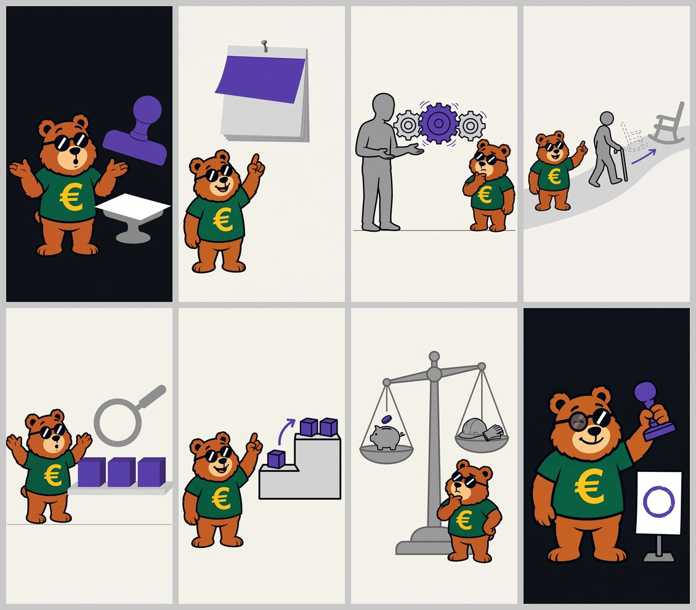

# Immagini: Vero o falso? «Il governo alza l'età pensionabile» (video TikTok)

Le 8 illustrazioni del video, una per idea, nell'ordine del production doc di `../copione.md`. Senza testi: «VERO O FALSO?», le cifre, il timbro «VERO A METÀ», i titoli, i sottotitoli e il fumetto "But Why Finance?" si aggiungono in montaggio.

| File | Contenuto |
|---|---|
| `01.png` … `08.png` | Immagini finali, PNG 1080x1920 (9:16) |
| `scene.json` | Scene in inglese (ingresso di `componi_prompt.py`), versione finale |
| `prompts.json` | Prompt finale di ogni immagine, con fondo e riferimenti |
| `anteprima.jpg` | Contact sheet (4 colonne) |

La copertina (`../copertina.png`) non è un'immagine generata: è composta da `../script/copertina.py` con l'immagine 01 e IBM Plex Sans Condensed Bold.

## Le 8 immagini

| # | Voce | Fondo | Oggetto / scena | Orso | Tentativo usato |
|---|---|---|---|---|---|
| 01 | «Vero o falso? … Ma perché?» | inchiostro | timbro con manico viola sospeso sopra un foglio bianco su un supporto grigio | sorpreso, zampe aperte | 1° |
| 02 | «Dal duemilaventisette, … Per quasi tutti» | carta | calendario a strappo grigio, pagine bianche, con un foglio viola nuovo in cima (il mese in più) | spiega, indice alzato | 3° |
| 03 | «È una regola:» | carta | tre ingranaggi che girano da soli (il grande viola); sagoma grigia senza volto con le mani aperte che non li tocca | pensieroso, mano al mento | 1° |
| 04 | «se a sessantacinque anni si vive … più tardi» | carta | sentiero in salita, sagoma con bastone, sedia a dondolo spostata più avanti (sagoma tratteggiata + freccia viola) | spiega, indice alzato | 3° |
| 05 | «Stavolta toccavano tre mesi:» | carta | tre cubi viola su una mensola, lente d'ingrandimento grigia | sorpreso | 1° |
| 06 | «la manovra ne ha rinviati due» | carta | due gradini: un cubo viola sul primo, due sul secondo, freccia viola che sale | spiega, indice alzato | 3° |
| 07 | «Banca d'Italia … Cgil …» | carta | bilancia in equilibrio: salvadanaio con moneta viola / casco e guanti da lavoro grigi | pensieroso, mano al mento | 2° |
| 08 | «Vero che sale … E tu, la terresti?» | inchiostro | lo stesso timbro viola alzato; foglio bianco con un anello viola timbrato (vuoto, il verdetto va in montaggio) | **occhiolino** (lente fumé) | 2° |

Unico accento viola (`#5B3FA8`, rubrica Vero o falso?), nessun rosso né rosa, nessun verde oltre alla maglietta, nessuna scritta/lettera/numero. Inchiostro solo su 01 e 08 (loop: stesso set, foglio bianco → foglio timbrato). Rispetto al post precedente (5 immagini, una per scena) qui ci sono 8 oggetti diversi.

## Come sono state generate

API Meta `POST /v1/images/edits`, `muse-image-1.0`, `size=1024x1792`, riferimento `brand/mascotte/mascotte-principale.jpg` (`image[0]`) + `brand/mascotte/espressioni.jpg` (`image[1]`) per l'occhiolino della 08; WebP 1152x2016 → 1134x2016 → 1080x1920. Script: `.claude/skills/crea-post-tiktok/scripts/` (`componi_prompt.py` → `genera_immagine.py` → `controlla_immagini.py` → `anteprima.py`).

## Cosa è stato rigenerato e perché

**16 immagini generate** (8 prime prove + 5 seconde + 3 terze), nessuna richiesta fallita, nessun 5xx, nessun blocco del filtro. Le prove scartate sono nello scratchpad, non nel repository.

| Img | Problema | Correzione |
|---|---|---|
| 02 | 1ª: orso grande, piedi all'89% (fascia bassa), calendario fino al bordo destro. 2ª: orso fino al 93% | 3ª: calendario più piccolo e più alto (fascia destra libera, 78,8%), orso più piccolo; i piedi restano al 90% → difetto noto |
| 04 | 1ª: orso tagliato dal bordo basso (99,7%). 2ª: piedi al 92% | 3ª: orso piccolo "in piedi sul sentiero", testa al 45% e piedi al 72%: contenuto fra 32% e 75% |
| 06 | 1ª e 2ª: la zampa al mento copre metà della € gialla; 1ª anche contenuto fino al bordo basso | 3ª: espressione "spiega, indice alzato" con l'altro braccio lungo il fianco: € libera, contenuto entro l'81% |
| 07 | 1ª: orso con i piedi al 92% | 2ª: orso più piccolo a destra della base della bilancia, piedi all'86% |
| 08 | 1ª: orso grande (accettabile) | 2ª: chiesto più piccolo; risultato simile, usata la 2ª perché `prompts.json` contiene il suo prompt |

01, 03 e 05 riuscite al primo tentativo.

## Controlli fatti

Ogni immagine guardata intera con Read (anche le prove scartate): nessuna scritta, cifra o segno (pagine del calendario bianche, cubi lisci, moneta liscia, anello del timbro vuoto), occhiali tondi neri con riflesso bianco in tutte, € gialla al centro del petto e scoperta in tutte le finali, sagome grigie senza volto né vestiti, niente rosso. Misure di `controlla_immagini.py` sulle immagini finali:

| # | Dimensioni | Fondo misurato | Contenuto da… a… (altezza) | Destra fino a | Avvisi |
|---|---|---|---|---|---|
| 01 | 1080x1920 | `#0E1218` (inchiostro) | 30,3% – 84,2% | 97,0% | contenuto nel 10% a destra |
| 02 | 1080x1920 | `#F4F1EA` (carta) | 11,5% – 90,4% | 78,8% | contenuto nel 15% in basso |
| 03 | 1080x1920 | `#F4F1E9` (carta) | 29,3% – 76,5% | 98,7% | contenuto nel 10% a destra |
| 04 | 1080x1920 | `#F3EFEA` (carta) | 32,2% – 75,4% | 100,0% | contenuto nel 10% a destra |
| 05 | 1080x1920 | `#F4F1EB` (carta) | 26,0% – 73,3% | 100,0% | contenuto nel 10% a destra |
| 06 | 1080x1920 | `#F4F1E9` (carta) | 37,0% – 81,1% | 97,9% | contenuto nel 10% a destra |
| 07 | 1080x1920 | `#F4F1EB` (carta) | 14,5% – 86,3% | 94,8% | contenuto nel 15% in basso; contenuto nel 10% a destra |
| 08 | 1080x1920 | `#0E1218` (inchiostro) | 25,0% – 85,6% | 95,0% | contenuto nel 15% in basso; contenuto nel 10% a destra |

## Difetti noti

- **Fascia bassa (02, 07, 08):** i piedi dell'orso arrivano al 90% (02), 86% (07), 86% (08): in montaggio sottotitoli su targhetta semi-opaca o vista alzata di 3-5%. Tre tentativi sulla 02 non sono bastati a rimpicciolire l'orso.
- **Fascia destra (01, 03-08):** foglio e supporto (01), ingranaggio piccolo (03), sedia (04), terzo cubo (05), gradini (06), piatto del casco (07), foglio timbrato (08) arrivano al 95-100% della larghezza. Nessun elemento chiave (occhiali, €, volto) è in quella fascia; nell'08 l'anello timbrato su cui va «VERO A METÀ» è al 72-90%: in montaggio spostare il timbro di testo un po' a sinistra, fuori dai pulsanti.
- **02:** le pagine del calendario hanno una leggera ombreggiatura grigia sul bordo (lo stile chiede colori pieni) e il chiodo è marrone-grigio; non si nota a misura di telefono.
- **03:** la sagoma grigia, con le mani aperte verso gli ingranaggi, si legge più come "ecco come funziona" che come "non sono io": va bene con la voce («È una regola»).
- **08:** l'orso è più grande del chiesto (~60% dell'altezza); l'occhiolino si legge attraverso la lente fumé come nella 05 del post precedente.

**Coerenza dell'orso:** stessa pelliccia ramata, muso pesca, occhiali tondi con riflesso diagonale, maglietta verde con € gialla in tutte e 8; proporzioni coerenti con `mascotte-principale.jpg`.

**Su TikTok va attivata l'etichetta "contenuto generato da IA".**
